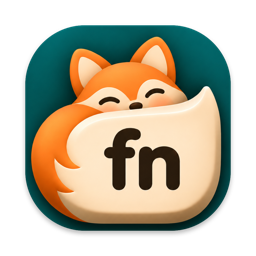
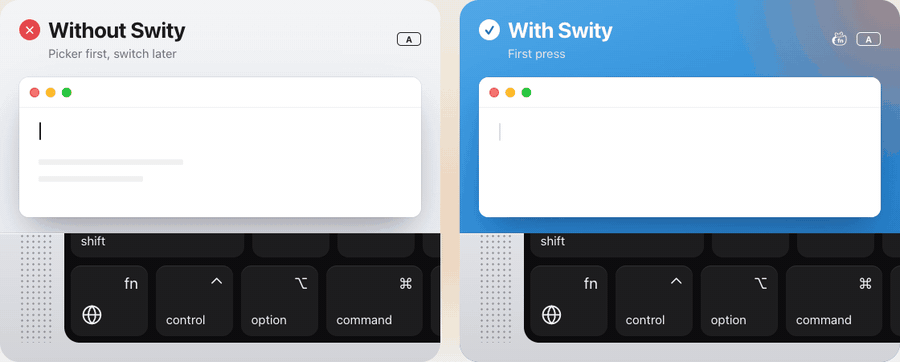

<p align="center"></p>

<h1 align="center">Swity</h1>

<p align="center">
  Switch keyboard language instantly on your Mac.<br>
  One press of 🌐 fn. No picker, no lag.
</p>

<p align="center">
  <a href="https://github.com/one-focus/swity/releases/latest/download/Swity.dmg"><b>Download for Mac</b></a>
  &nbsp;·&nbsp;
  <a href="https://swity.io">swity.io</a>
</p>

<p align="center">
  
</p>

On a Mac, 🌐 fn shows the input source picker first and switches a moment later. Type right away
and the first letters come out in the old layout: "ma;ana" instead of "mañana". Swity switches the
moment the key goes down.

Free and open source. A 2 MB menu bar app for Intel and Apple Silicon Macs, macOS 12 or later,
signed and notarized.

## Install

1. [Download Swity.dmg](https://github.com/one-focus/swity/releases/latest/download/Swity.dmg) and
   drag Swity to Applications.
2. Open it and allow **Input Monitoring** when it asks. That is how it sees the 🌐 fn key.
3. Press 🌐 fn.

To remove it, quit Swity from its menu bar icon and move it to the Trash.

## How it works

- 🌐 fn switches to the next input source you have turned on, input methods such as Pinyin,
  Japanese and Korean included.
- fn held with another key (fn+arrow, fn+delete) is a shortcut, not a switch.
- A keyboard without 🌐 fn, or one whose fn never reaches the Mac (many Windows and third-party
  keyboards), switches with a short press of left Control. Control held with another key, a click or
  a longer hold stays plain Control, and a keyboard with fn keeps Control as it is.
- While Swity runs, the system's "Press 🌐 key to" is set to "Do Nothing", so nothing switches
  twice. Your own setting comes back when Swity quits.
- It starts with your Mac and updates itself from swity.io.

## Privacy

Swity collects nothing. It goes online only to check swity.io for an update and to download one.

Input Monitoring lets it see the modifier keys, and that some other key or a mouse button went down
while one of them was held. Which key it was is never read, stored or sent. The whole app is one file,
[`main.swift`](main.swift), so you can check.

## Build from source

You need the Xcode command line tools (`xcode-select --install`).

```sh
./build.sh       # build, install to /Applications and launch
./build.sh dmg   # build Swity.dmg
```

Without a "Developer ID Application" certificate the build is signed ad hoc, which is fine for your
own Mac. Only the build signed by swity.io updates itself.

## Contributing

Bug reports and pull requests are welcome. If something doesn't switch the way you expect, say
which macOS version and which input sources you use.

## License

The code is under the [GNU General Public License v3.0](LICENSE).

The name "Swity" and the fox artwork (`AppIcon.icns`, `MenuIconTemplate.tiff`, `DmgBackground.tiff`
and everything in `docs/`) are not covered by it. If you distribute your own build, give
it a different name and icon.

Copyright © 2026 Alexandr Kardash.
